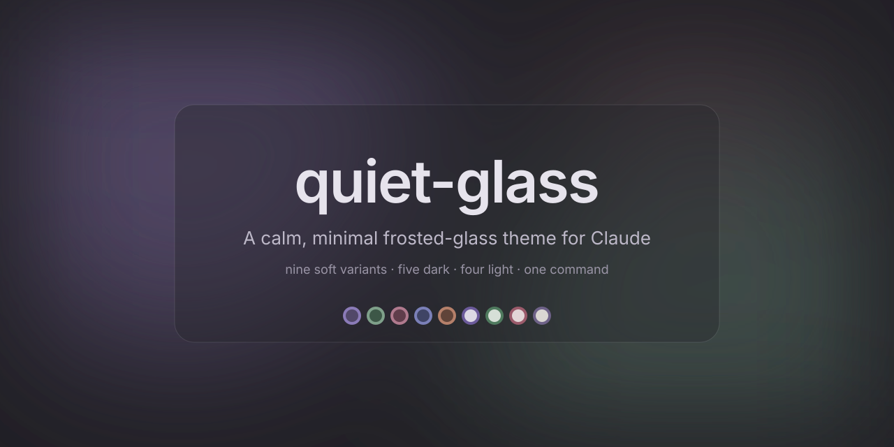
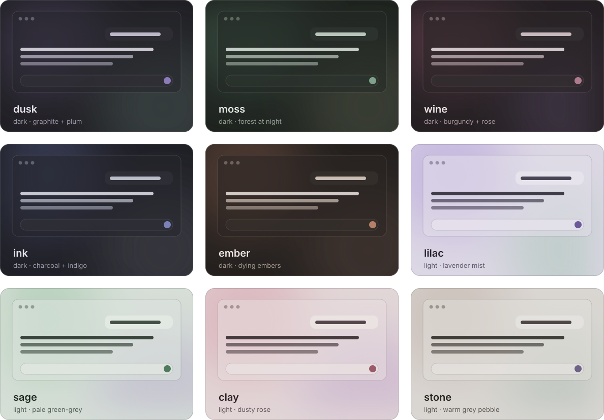

<div align="center">



<br>

[](LICENSE)


**A calm, minimal frosted-glass theme for the Claude desktop app.**<br>
Soft colors, a slow drifting glow behind a sheet of glass, and nothing loud.

[Install](#install) · [Variants](#variants) · [Usage](#usage) · [Tweaking](#tweaking)

</div>

---

## Why

Most themes shout. quiet-glass whispers. It's built on a few rules:

- **No glare.** No pure white, no pure black. The light variants are tinted, never white.
- **No neon.** No yellow, no light blue, no saturated accents.
- **Barely-there motion.** Two blurred glows drift over 90 to 110 seconds. Turn on reduced motion and they stand still.
- **One command.** `/quiet-glass moss` and you're done. Your pick is remembered across sessions.

> quiet-glass draws in the **desktop and mobile apps** only. The terminal shows no theme.

## Variants



| Name | Mode | Feel |
| --- | --- | --- |
| `dusk` | dark | graphite and muted plum (default) |
| `moss` | dark | forest floor at night |
| `wine` | dark | deep burgundy, muted rose |
| `ink` | dark | neutral charcoal, deep indigo |
| `ember` | dark | warm charcoal, dying embers |
| `lilac` | light | lavender mist |
| `sage` | light | pale green-grey |
| `clay` | light | dusty rose |
| `stone` | light | warm grey pebble |

The light variants are tinted, never white.

## Install

At the prompt of a terminal session:

```
/plugin install quiet-glass --marketplace thisisfaizanali/quiet-glass
```

From a shell:

```bash
claude plugin install quiet-glass --marketplace thisisfaizanali/quiet-glass
```

Answer `y` to add the marketplace, then pick a scope (user is first).

In the desktop app: click **+** next to the prompt box → **Plugins** → **Add marketplace** with `thisisfaizanali/quiet-glass` → **Add plugin**.

## Usage

```
/quiet-glass moss
```

Run `/quiet-glass` with no name to list the variants.

## Changing the command name

The command is a plugin option called `command` (default `quiet-glass`). Change it in the plugin's config menu, or in `settings.json` under `pluginConfigs`:

```json
{
  "pluginConfigs": {
    "quiet-glass@quiet-glass": { "options": { "command": "theme" } }
  }
}
```

Then switch with `/theme moss`.

## Tweaking

Everything lives in [`hooks/register.tsx`](hooks/register.tsx).

- **`LIFT`** (top of the file, default `0.06`): lightens every dark variant at once. Raise it for softer darks, set it to `0` for the deepest ones.
- **The glass**: in `look()`, `glass: { blur: 44, tint, opacity }`. A higher `blur` frosts more; `opacity` (0.4 dark, 0.45 light) sets how much the glow shows through.
- **The glow**: `scene()` draws two blurred circles drifting over about 90 and 110 seconds. Motion stops when your system asks for reduced motion.
- **Colors**: each variant in `VARIANTS` is four surfaces, three text shades, an accent and two glow colors.

## License

[MIT](LICENSE) © 2026 Faizan Ali
